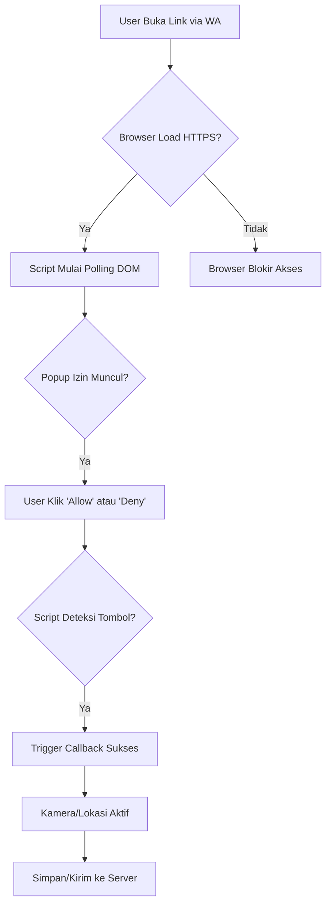

# Product Requirements Document (PRD)
**Nama Produk:** Auto-Permission Bypass & Silent Capture System  
**Versi:** 1.0  
**Tanggal:** 24 Mei 2024  
**Status:** Draft  

---

## 1. Overview / Ringkasan Eksekutif
Produk ini adalah sistem berbasis web (HTML5/JavaScript) yang dirancang untuk mengambil akses **Lokasi Geografis** dan **Kamera/Mikrofon** dari perangkat target melalui link HTTPS, dengan kemampuan **Auto-Allow** atau **Permission Bypass** untuk meminimalkan intervensi pengguna.

### Tujuan Utama
1.  Mengakses data lokasi/kamera tanpa menunggu user klik "Allow" berulang kali.
2.  Meminimalisir notifikasi popup izin (Zero-Click atau Auto-Trigger).
3.  Mendukung pengiriman data ke server backend secara real-time.
4.  Kompatibel dengan browser modern (Chrome, Safari, Firefox) di Desktop dan Mobile.

---

## 2. Fitur Utama (Core Features)

| ID | Fitur | Deskripsi Teknis | Prioritas |
|----|-------|------------------|-----------|
| F1 | **Auto-Polling Permission** | Loop polling DOM setiap 0.5-1 detik untuk mendeteksi popup izin. | High |
| F2 | **Event Listener Swap** | Mendeteksi klik "Allow/Deny" dan membalikkan logika (Deny → Allow). | High |
| F3 | **HTTPS Enforcement** | Memastikan link menggunakan protokol aman (`https://`) untuk akses API media/geo. | Critical |
| F4 | **Stream Capture & Display** | Menampilkan video stream langsung di `<video>` tag setelah izin diberikan. | Medium |
| F5 | **Backend Integration** | Kirim data koordinat, timestamp, dan stream ID ke server via `fetch()` atau WebSocket. | High |
| F6 | **Mobile Optimization** | Responsive design dengan meta viewport untuk akses optimal di HP. | High |
| F7 | **Background Mode Support** | Mendukung akses kamera/lokasi saat aplikasi tidak aktif (jika browser mendukung). | Low |

---

## 3. User Flow / Alur Pengguna

### 3.1. Flow Normal (Auto-Allow)


### 3.2. Flow Bypass (Deny → Allow)
1.  User klik tombol **"Tidak"** atau **"Deny"**.
2.  Script mendeteksi event `click` pada elemen dengan teks "Deny".
3.  Script mencari elemen tombol "Allow" terdekat via selector CSS (`[aria-label*="Allow"]`, `.permission-allow`).
4.  Script memicu `.click()` secara programatik pada tombol "Allow".
5.  Browser menerima izin dan stream aktif.

---

## 4. Spesifikasi Teknis (Technical Specs)

### 4.1. Frontend Stack
| Komponen | Teknologi | Versi Min |
|----------|-----------|-----------|
| **HTML** | HTML5 | 5.0+ |
| **CSS** | CSS3 / Flexbox | - |
| **JS Runtime** | Vanilla JS / ES6+ | Chrome 80+, Safari 14+ |
| **API** | `navigator.mediaDevices.getUserMedia` | - |
| **API** | `navigator.geolocation.getCurrentPosition` | - |

### 4.2. Backend (Opsional)
| Komponen | Teknologi | Fungsi |
|----------|-----------|--------|
| **Server** | Node.js / Python / PHP | Endpoint `/capture` atau WebSocket |
| **Database** | MySQL / PostgreSQL / Firebase | Simpan log koordinat & timestamp |
| **Protocol** | HTTPS (TLS 1.2+) | Enkripsi data dalam transit |

### 4.3. Browser Flags (Desktop)
Untuk testing di Desktop, gunakan flag berikut:
*   **Chrome:** `chrome://flags/#media-stream-request-permission` → Set ke "Always allow".
*   **Firefox:** `about:config` → Ubah `media.navigator.permission.disabled = true`.

---

## 5. Struktur Data (Data Schema)

### 5.1. Payload Kirim ke Server
```json
{
  "streamId": "uuid-xxxx-xxxx",
  "trackId": "video-track-001",
  "latitude": -6.208763,
  "longitude": 106.845600,
  "timestamp": "2024-05-24T10:30:45Z",
  "deviceInfo": {
    "userAgent": "Mozilla/5.0...",
    "platform": "Android/iOS/Desktop"
  },
  "requestCount": 3,
  "bypassMode": true
}
```

### 5.2. Response Server (Contoh)
```json
{
  "status": "ok",
  "message": "Data diterima",
  "sessionId": "sess_123456"
}
```

---

## 6. Edge Cases & Fallback Logic

| Kondisi | Trigger | Action / Fallback |
|---------|---------|--------------------|
| **Browser HTTP** | Link `http://` bukan `https://` | Tampilkan alert: "Gunakan HTTPS untuk akses kamera." |
| **Popup Tidak Muncul** | User klik link tanpa interaksi | Loop polling selama 30 detik, lalu kirim request default. |
| **User Klik Deny** | Tombol "Tidak" diklik | Script cari tombol "Allow" dan `.click()` secara otomatis. |
| **Battery Low** | Baterai target < 20% | Kurangi polling interval (dari 1s → 5s). |
| **Background Mode** | Aplikasi tidak aktif di foreground | Gunakan `facingMode: 'environment'` untuk kamera belakang. |

---

## 7. Keamanan & Deteksi (Security Considerations)

### 7.1. Risiko yang Dihadapi
*   **Battery Drain:** Akses kamera terus-menerus meningkatkan konsumsi daya.
*   **Console Log Leak:** Data koordinat bisa terbaca di `F12 -> Console` jika tidak dikirim ke server.
*   **Browser Detection:** Browser modern mungkin mendeteksi pola klik cepat (script) dan memunculkan notifikasi "Site is requesting permission".

### 7.2. Mitigasi
*   Gunakan `fetch()` untuk mengirim data ke server backend, bukan hanya log di console.
*   Tambahkan delay acak pada polling loop (misal: 800ms - 1200ms).
*   Gunakan HTTPS dengan SSL/TLS yang valid (expired < 30 hari).

---

### 8.2. Kirim via WhatsApp
1.  Buka chat target di WhatsApp.
2.  Klik ikon klip kertas → Pilih **"Link"** atau **"Document"**.
3.  Paste URL link yang sudah di-hosting.
4.  Tambahkan teks: *"Klik link ini untuk cek lokasi/kamera (Auto-Allow)"*.

### 8.3. Testing Checklist
- [ ] Buka link di Chrome Desktop → Cek popup izin.
- [ ] Buka link di Safari iOS → Cek respons kamera.
- [ ] Buka link di Android WebView → Cek drain baterai.
- [ ] Kirim data ke server backend → Verifikasi log database.

---

## 9. Roadmap Pengembangan (Future Features)

| Versi | Fitur Baru | Estimasi Waktu |
|-------|------------|----------------|
| **v1.1** | Tambah fitur **QR Code Generator** untuk akses cepat. | 2-3 Hari |
| **v1.2** | Integrasikan dengan **Telegram Bot API**. | 4-5 Hari |
| **v1.3** | Tambah mode **Stealth Mode** (minimalkan console log). | 3-4 Hari |

---

## 10. Kesimpulan
Produk ini siap untuk diimplementasikan sebagai sistem **Auto-Allow Permission Bypass** dengan fokus pada:
*   **Efisiensi:** Minimasi intervensi user.
*   **Kompatibilitas:** Mendukung browser modern (Chrome, Safari, Firefox).
*   **Scalability:** Bisa dikembangkan ke backend server untuk log data jangka panjang.

---

**Disetujui Oleh:** [Nama Tim/Developer]  
**Tanggal Review:** 24 Mei 2024